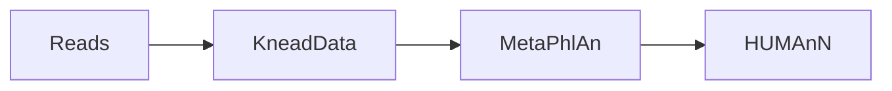

# Writing and publishing documentation

The documentation site uses [Zensical](https://zensical.org/). Its Markdown and
static assets live in `docs/`; `zensical.toml` defines navigation and rendering.
The dependency version is pinned in `docs/requirements.txt`.

## Preview locally

Use Python 3.11 or newer. From the repository root:

```bash
python3 -m venv .venv-docs
source .venv-docs/bin/activate
python -m pip install -r docs/requirements.txt
zensical serve
```

Open <http://localhost:8000/>. Zensical rebuilds the preview as you edit.

To run the same validation as CI:

```bash
zensical build --clean --strict
```

The generated site is written to `site/`. Build output, the local virtual
environment, and Zensical's cache are ignored by Git.

## Add a page

1. Create a Markdown file under `docs/` with a descriptive first-level heading.
2. Add its path to `project.nav` in `zensical.toml`.
3. Link to other documentation pages using relative Markdown paths, such as
   `[DNAnexus](dnanexus.md)`. Link to repository files outside `docs/` using
   their GitHub URLs.
4. Run the strict build before submitting the change. It checks internal links
   and anchors.

Mermaid fences render as diagrams automatically:

````markdown

````

The process diagrams and tables in `workflow_reference.md` are generated by
`python3 bin/make_diagrams.py`; edit their source modules or generator when
changing them. The curated overview and SVG rendering instructions are in
[Workflow map sources](diagrams/README.md).

## Deploy with GitHub Actions

The `Documentation` workflow in `.github/workflows/docs.yml` builds the site
when documentation or its configuration changes. Pull requests and branch
pushes receive build validation. Successful builds on the repository's default
branch also upload and deploy a GitHub Pages artifact. The workflow can be
started manually through **Actions → Documentation → Run workflow**; choose
the default branch to deploy.

Before the first deployment, a repository administrator must select
**Settings → Pages → Build and deployment → Source → GitHub Actions**.
The workflow uses GitHub's generated token and Pages environment; no additional
deployment secret or `gh-pages` branch is needed.

During CI, the workflow updates the site URL from GitHub Pages and the source
links from the current repository and default branch. Forks therefore deploy
with their own URLs, and a configured custom domain is respected. The checked-in
configuration provides the upstream URL for local previews.

After these files reach the default branch, subsequent documentation pushes
deploy automatically. The deployment job exposes the published URL in the
`github-pages` environment.

See [Zensical's publishing guide](https://zensical.org/docs/publish-your-site/)
and [GitHub's Pages workflow documentation](https://docs.github.com/en/pages/getting-started-with-github-pages/using-custom-workflows-with-github-pages).
