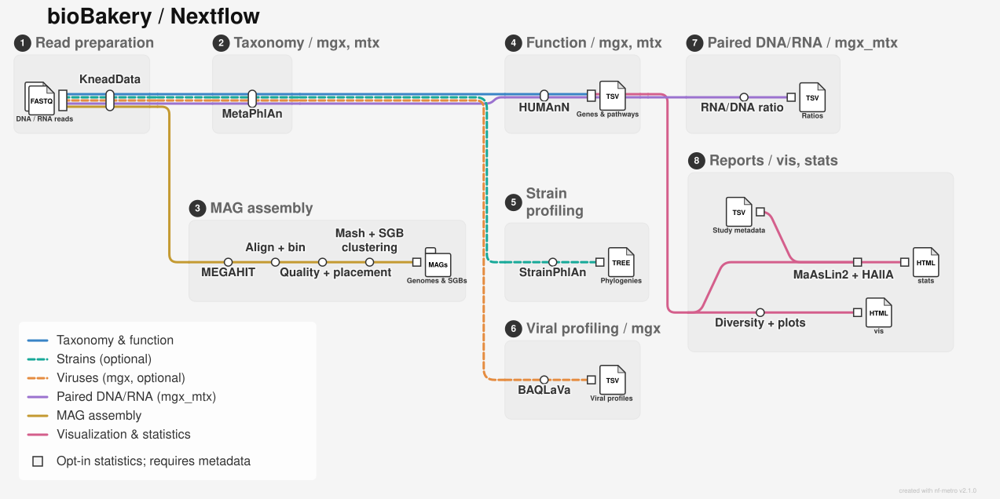

# bioBakery Nextflow

Nextflow workflows for microbial community analysis: metagenomic and
metatranscriptomic profiling, genome assembly, visualization, and statistics.

## Get started

Start with [Implementing bioBakery on your own infrastructure](get-started/index.md).
The guide introduces the analysis workflows and takes you from a new HPC
environment to a first test run: find and load an available container runtime,
pull the images, use those containers to install databases, copy a minimal
SLURM or local configuration, and submit the test.

Already using a configured installation? Choose your
[environment guide](environments/index.md) for the relevant profile and local
setup notes.

| Guide | Contents |
| --- | --- |
| [Workflow reference](workflow_reference.md) | Generated diagrams and process tables for each analysis route |
| [MetaPhlAn databases](metaphlan_databases.md) | Multiple references and downstream database selection |
| [DNAnexus](dnanexus.md) | Applet builds, cached images, reference staging, and cloud execution |
| [Wellesley Hopper](wellesley_hopper.md) | Local Docker execution with the Hopper site configuration |

## Develop and contribute

- [Software dependencies](dependencies.md) describes tool environments and version compatibility.
- [Workflow utilities](workflow_utilities.md) documents the helpers used by the pipeline.
- [Architecture and migration](architecture.md) records the port's design and implementation history.
- [Visualization and statistics port](vis_stats_port_status.md) records reporting behavior and compatibility decisions.
- [Workflow map sources](diagrams/README.md) explains how the overview and generated diagrams are maintained.
- [Writing and publishing documentation](documentation.md) covers local previews and GitHub Pages deployment.
